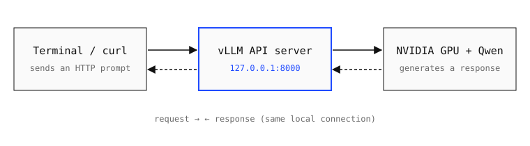

*Last tested November 2026 on Windows 11 + WSL2.*

Want to run an AI model on your own GPU instead of a cloud service like ChatGPT or Claude? This guide walks you through it on Windows, step by step: install Ubuntu with WSL2, set up vLLM, serve a small open model, and send it your first prompt from the terminal.

You'll need basic command-line experience. No prior experience hosting AI models is required. Each phase ends with a **checkpoint** so you can confirm everything works before moving on.

## Before You Begin: Requirements

| Item | Requirement |
|---|---|
| **Computer** | Windows 11 with administrator access, at least 30 GB of free disk space, and a stable internet connection (10 Mbps or faster) for the software and model downloads. |
| **GPU** | A compatible NVIDIA GPU (vLLM lists compute capability 7.5 or higher). An 8 GB GPU is a practical example for the small model used below; actual memory use varies. |
| **Software** | A current NVIDIA Windows GPU driver, PowerShell, WSL2 with Ubuntu, a Python 3.12 environment, and vLLM. You'll install the last two in this guide. |
| **Knowledge** | Basic terminal commands, and the ability to tell Windows PowerShell commands apart from Ubuntu commands. |

## Phase 1 — Verify the GPU and Install Ubuntu

### 1. Check the GPU in Windows

Open PowerShell and run the command below. Look for your NVIDIA GPU's name and driver version. If the command isn't recognized, install or update the NVIDIA Windows driver from NVIDIA's official website before continuing.

```powershell
nvidia-smi
```

The output should show your GPU's name, driver version, and memory capacity.

### 2. Install or open WSL2

Open PowerShell as administrator and install WSL with Ubuntu (Microsoft, 2025). If WSL and Ubuntu are already installed, skip the first command. Restart Windows if prompted, then launch Ubuntu and create a Linux username and password.

```powershell
wsl --install -d Ubuntu
wsl --update
wsl --list --verbose
```

If the `VERSION` column shows `1` for Ubuntu, convert it to WSL2:

```powershell
wsl --set-version Ubuntu 2
```

> **CHECKPOINT 1:** The WSL list shows Ubuntu with version `2`. Now open the Ubuntu terminal and run `nvidia-smi` again. If you see your GPU, Linux can access the Windows GPU driver (NVIDIA Corporation, 2026). If Ubuntu can't see the GPU, stop and see [Troubleshooting](#troubleshooting) before installing vLLM.

## How the Pieces Connect



*Figure 1. A terminal sends a request to the vLLM server, which uses the local GPU and model to generate a reply.*

## Phase 2 — Create the Python Environment

### 3. Prepare Ubuntu and create a working folder

In the Ubuntu terminal, install basic download tools and create a dedicated folder. Keeping everything in one folder makes the setup easy to find, organize, and remove later.

```bash
sudo apt update
sudo apt install -y curl ca-certificates
mkdir -p ~/local-vllm && cd ~/local-vllm
```

### 4. Install uv and create an isolated Python environment

In the **Ubuntu terminal (not Windows PowerShell)**, run the commands below one line at a time. They install [uv](https://docs.astral.sh/uv/) (a fast Python package and environment manager), create a separate Python 3.12 environment for vLLM, and activate it (Astral, 2026; vLLM Project, 2026a). A virtual environment keeps vLLM's packages separate from your other Python projects.

```bash
curl -LsSf https://astral.sh/uv/install.sh | sh
export PATH="$HOME/.local/bin:$PATH"
uv venv --python 3.12 --seed --managed-python
source .venv/bin/activate
```

> **CHECKPOINT 2:** Your prompt now starts with `(.venv)`, and `python --version` reports Python 3.12.x. If `uv` isn't found, close and reopen Ubuntu, run `cd ~/local-vllm`, and try again.

### 5. Install vLLM and its GPU dependencies

> **CAUTION:** Don't try to fix errors by installing random CUDA packages or mixing in unrelated PyTorch versions. Mismatched binaries can stop vLLM from starting, so check the official vLLM installation guide first (vLLM Project, 2026a). Also, install the NVIDIA display driver on **Windows only**. Don't install a second Linux NVIDIA display driver inside WSL (NVIDIA Corporation, 2026).

With `(.venv)` active, run these commands one at a time. The first installs vLLM; `--torch-backend=auto` picks a PyTorch build that matches your NVIDIA driver. The second is optional and pre-downloads compatible FlashInfer kernels. The third confirms the install (vLLM Project, 2026a). The first download is large, so expect it to take a while.

```bash
uv pip install vllm --torch-backend=auto
vllm download-kernels
vllm --version
```

## Phase 3 — Start the Model and Test It

### 6. Launch a small instruction-tuned model

In the same Ubuntu window, start the server with [Qwen2.5-1.5B-Instruct](https://huggingface.co/Qwen/Qwen2.5-1.5B-Instruct) (Qwen Team, n.d.). The first time you run it, vLLM downloads the model files (a few GB) from Hugging Face; later runs use the cached copy. The settings below use a short context window and cap GPU memory use so the example fits on smaller GPUs.

```bash
vllm serve Qwen/Qwen2.5-1.5B-Instruct \
  --host 127.0.0.1 --port 8000 \
  --max-model-len 2048 --gpu-memory-utilization 0.80
```

> **CHECKPOINT 3:** Wait until the log says the application has started and the server is listening on port 8000. Leave this window running. If it exits with an out-of-memory error, see [Troubleshooting](#troubleshooting).

### 7. Send a test prompt from a second Ubuntu window

Open a second Ubuntu terminal (you don't need to activate the virtual environment here, since these commands only use `curl`). First, ask the server which models it's serving:

```bash
curl -sS http://127.0.0.1:8000/v1/models
```

Then send a chat request (vLLM Project, 2026b). It contains the model name, your message, and a limit on the response length:

```bash
curl -sS http://127.0.0.1:8000/v1/chat/completions \
  -H "Content-Type: application/json" \
  -d '{"model":"Qwen/Qwen2.5-1.5B-Instruct",
       "messages":[{"role":"user",
                    "content":"Explain a GPU in one sentence."}],
       "max_tokens":60}'
```

> **CHECKPOINT 4:** The response is JSON with the model's answer under `choices[0].message.content` (vLLM Project, 2026b). The wording changes from run to run. If you see "connection refused," the server isn't running or the address or port is wrong.

### 8. Shut down the server

Go back to the first Ubuntu terminal and press **Ctrl+C**. This stops the server and frees the GPU memory it reserved. The installed packages and downloaded model stay on disk, so next time you only need to run:

```bash
cd ~/local-vllm
source .venv/bin/activate
vllm serve Qwen/Qwen2.5-1.5B-Instruct \
  --host 127.0.0.1 --port 8000 \
  --max-model-len 2048 --gpu-memory-utilization 0.80
```

## Troubleshooting

**GPU not detected.** If `nvidia-smi` shows an error or can't find your GPU, update the NVIDIA Windows driver, confirm Ubuntu is running on WSL version 2 (`wsl --list --verbose`), and run `nvidia-smi` inside Ubuntu again. Don't install a separate Linux display driver (NVIDIA Corporation, 2026).

**Out-of-memory error.** If the server reports `CUDA out of memory`, your GPU doesn't have enough free memory for the current settings. Close other apps that use the GPU (games, browsers with hardware acceleration), stick with the small model, and try lowering `--max-model-len` to `1024` or `--gpu-memory-utilization` to `0.70`.

**Installation or kernel error.** If vLLM fails to install or reports a missing library or kernel, check that `(.venv)` appears in your prompt and that `python --version` shows 3.12. If the error continues, consult the official vLLM installation guide and rerun `vllm download-kernels` after installing or updating vLLM (vLLM Project, 2026a).

**Port 8000 already in use.** If the server reports `Address already in use`, another program (often an earlier vLLM server) is using port 8000. Stop it with Ctrl+C, or pick a different `--port` and use that same port in both `curl` commands.

## Completion Check

You're done when:

1. `nvidia-smi` inside Ubuntu shows your NVIDIA GPU.
2. The vLLM server starts and reports that it's listening on port 8000.
3. The `/v1/models` request returns JSON containing your model's name.
4. The `/v1/chat/completions` request returns JSON with a generated reply under `choices[0].message.content`.

If all four work, you're running an AI model locally with vLLM.

## Sources

Astral. (2026, November 3). *Installation*. uv documentation. Retrieved November 11, 2026, from <https://docs.astral.sh/uv/getting-started/installation/>

Microsoft. (2025, December 1). *Basic commands for WSL*. Microsoft Learn. Retrieved November 11, 2026, from <https://learn.microsoft.com/windows/wsl/reference>

NVIDIA Corporation. (2026, November 2). *CUDA on WSL user guide* (Release 13.5). Retrieved November 11, 2026, from <https://docs.nvidia.com/cuda/wsl-user-guide/index.html>

Qwen Team. (n.d.). *Qwen2.5-1.5B-Instruct* [Model card]. Hugging Face. Retrieved November 11, 2026, from <https://huggingface.co/Qwen/Qwen2.5-1.5B-Instruct>

vLLM Project. (2026a, October 8). *GPU* [Installation guide]. vLLM documentation. Retrieved November 11, 2026, from <https://docs.vllm.ai/en/latest/getting_started/installation/gpu/>

vLLM Project. (2026b, November 6). *OpenAI-compatible server*. vLLM documentation. Retrieved November 11, 2026, from <https://docs.vllm.ai/en/latest/serving/online_serving/openai_compatible_server/>
